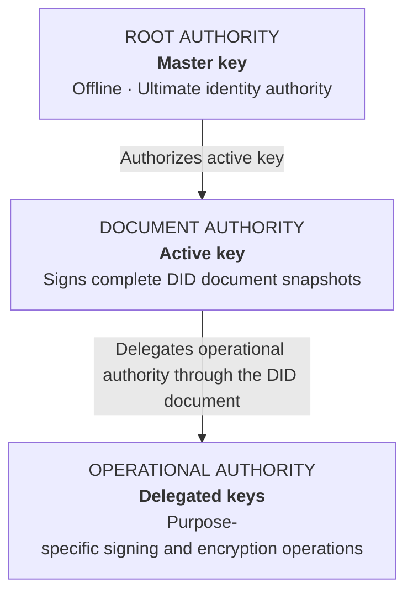

# artistDID Core Specification

v1.0 · 20 November 2026

This document defines the artistDID Core architecture and serves as the baseline for the reference implementation and any separate extension specifications.

## 1. Project definition

artistDID is a decentralized identity protocol designed for artists and creative entities.

It provides a persistent, self-controlled digital identity that can be used across applications, platforms, creative works, professional relationships and publication systems.

The protocol is intended for artists and creative entities of any discipline, including musicians, visual artists, writers, filmmakers, performers, designers, architects, digital artists, multidisciplinary practitioners and collectives.

artistDID does not define who qualifies as an artist. It provides identity infrastructure that creative individuals and entities can use independently of any particular platform or institution.

**Project identity**

| Element             | Definition            |
| ------------------- | --------------------- |
| Project             | artistDID             |
| DID method          | `did:artist`          |
| Website             | `artistdid.org`       |
| GitHub organization | `artistDID`           |
| Key roles registry  | `artistDID/key-roles` |

### 1.1 Core principles

1. Self-sovereign identity: The artist or creative entity owns and controls its identity.
2. Decentralization: No mandatory central account, registry, resolver, server or wallet.
3. Persistence: Identity is independent of artist name, application, device, hosting provider or publication infrastructure.
4. Cryptographic authority: Control is established through cryptographic keys and explicit authorization.
5. Separation of concerns: Identity, authentication, verification, profiles and artwork publication are distinct protocol components.
6. Interoperability: A DID can be used by independent applications and services.
7. Privacy: The DID document is public identity infrastructure, not a repository for private contact information.
8. Extensibility: Applications can introduce custom key roles and complementary services without changing the core identity model.

## 2. Architecture overview

artistDID combines the core protocol with optional extensions and supporting tools.

| Component          | Responsibility                                                                       |
| ------------------ | ------------------------------------------------------------------------------------ |
| artistDID Core     | Identifier, authority, authentication, external verification and artwork publication |
| artistDID Profile  | Optional public-facing artist representation                                         |
| artistDID Wallet   | Optional key management and identity operations                                      |
| Key Roles Registry | Community registry of standardized key roles                                         |

The core protocol is addressed in this document: identifier and authority in Sections 3–8, authentication and WebAuthn in Section 11, external verification in Section 12, and artwork publication in Section 13. The other components build on the core without becoming mandatory dependencies.

## 3. Identifier

### 3.1 DID format

The DID method is:

`did:artist`

A DID contains a self-certifying 32-byte identifier encoded using Bech32m. The identifier is derived from the master public key, not generated independently.

For the initial protocol version, construct this identifier payload using the canonical Bech32m `s` encoding of the master public key:

```json
{
  "purpose": "artistdid-identifier",
  "version": 1,
  "master": "s1..."
}
```

The identifier bytes are `SHA-256(JCS(payload))`, using the canonicalization defined in Section 4.7. The object contains exactly the fields shown; the master key must decode to a valid 32-byte Ed25519 public key. Version 1 fixes the master key algorithm. Bech32m-encode the resulting hash with the `a` prefix.

The purpose, version and canonical key representation distinguish this hash input from other protocol payloads and bind it to the version's key interpretation.

A verifier must recompute this identifier from `authority.master` and reject a mismatch. This establishes the initial master binding without a registry, trusted first-use record or separately distributed genesis document. It proves cryptographic control, not the artist's real-world identity or document freshness.

Example:

`did:artist:a1...`

The Bech32m human-readable prefixes are:

| Prefix | Meaning               |
| ------ | --------------------- |
| `a`    | artistDID identifier  |
| `s`    | Signing public key    |
| `e`    | Encryption public key |

Examples:

- `did:artist:a1...`
- `s1...`
- `e1...`

The `1` character is the Bech32 separator, not a protocol version.

Abbreviated identifiers and keys shown with ellipses are placeholders, not complete valid encodings.

The master keypair is generated using cryptographically secure randomness. The identifier does not encode an artist's name, location, discipline or other personal information.

Bech32m encoding follows the standard length constraints. Identifiers and public keys use canonical lowercase encoding; the initial suite requires 32 decoded bytes and the appropriate prefix.

Active and delegated key rotations preserve the DID. Replacing the master key creates a successor DID.

### 3.2 Cryptographic suite

The initial protocol suite is fixed as follows:

| Function                 | Algorithm                 |
| ------------------------ | ------------------------- |
| Digital signatures       | Ed25519                   |
| Key agreement            | X25519                    |
| Key derivation           | HKDF-SHA-256              |
| Authenticated encryption | XChaCha20-Poly1305        |
| Canonical JSON           | RFC 8785 JCS              |
| Signature encoding       | Base64url without padding |

The cryptographic suite is defined by the document format version, not selected by applications or individual key roles. Version 1 fixes all primitives in this section and applies them to every corresponding key and operation, including custom roles.

Implementations must dispatch cryptographic parsing and validation from the authenticated document version. Unsupported document versions must be rejected rather than interpreted using a different suite.

### 3.3 Document format version

DID documents use the root property `version`, initially with the integer value `1`.

The version identifies the document format and protocol rules. It is not a revision counter, publication sequence or timestamp. Ordinary document updates and key rotations do not change it.

Implementations must reject unsupported versions.

Each document type, including Profile, defines its own supported format versions. Versions do not need to advance together across specifications. The editorial version of this architecture document is independent of protocol format versions.

Payload purposes such as `artistdid-identifier` are fixed by the applicable protocol version; they are not independently configurable version fields.

## 4. Key architecture

artistDID separates signing keys from encryption keys and assigns keys to roles according to their purpose.

### 4.1 Key entry structure

A key entry has the following generic structure:

```json
{
  "public": "s1...",
  "timestamp": "2026-11-18T10:00:00Z"
}
```

Encryption keys use the `e` prefix.

Fields:

- `public`: Encoded public key.
- `timestamp`: Implementation-generated timestamp indicating when the key was introduced.

An optional `invalidated` field identifies when a key became invalid due to compromise or another security event.

Keys do not contain individual algorithm declarations. Their algorithms are determined by the authenticated DID document version.

### 4.2 Key structure and lifecycle

Two key structures are supported:

| Structure                  | Use when                                                                             | Replacement behavior                                                          |
| -------------------------- | ------------------------------------------------------------------------------------ | ----------------------------------------------------------------------------- |
| **Single key** (object)    | Only the current key is needed.                                                      | Replacing the object removes the previous key from the current DID document.  |
| **Historical key** (array) | Retired public keys must remain available for historical verification or decryption. | Append the replacement; existing entries remain available as historical keys. |

#### Historical key array rules:

- The array must contain at least one entry.
- Entries must have strictly increasing `timestamp` values.
- The last entry is the current key.
- Earlier entries are retired keys.
- A retired key can never become current again.

The timestamp of a newly introduced key defines the superseding boundary of the previous key. A key's `invalidated` timestamp, when present, takes precedence for validity during its lifecycle.

### 4.3 Signing key roles

| Role      | Purpose                                  | Structure        |
| --------- | ---------------------------------------- | ---------------- |
| `active`  | Signs complete DID document snapshots    | Single           |
| `auth`    | Proves current control of the DID        | Single           |
| `publish` | Signs artwork and publication records    | Historical array |
| `attest`  | Signs standalone claims and attestations | Historical array |
| `profile` | Signs optional artist Profile documents  | Provider-defined |

The `active`, `auth`, `publish` and `attest` roles are mandatory, and are created with the DID. `publish` and `attest` keys use historical key arrays because previous signatures must remain verifiable. The `profile` role is optional until a Profile is created, at which point it is required.

The exact lifecycle of the `profile` role is defined by the Profile specification.

### 4.4 Encryption key roles

| Role        | Purpose                                           | Structure        |
| ----------- | ------------------------------------------------- | ---------------- |
| `content`   | Persistent content and data encryption            | Historical array |
| `operation` | Operational communications and protocol exchanges | Historical array |

Encryption roles are optional and introduced when needed. A present historical array must be nonempty; an identity without encryption keys uses an empty `encryption` object.

### 4.5 Custom roles

Applications and communities may define additional roles, such as:

- `licensing`
- `financial`
- `audit`
- `certification`
- `messaging`

Custom roles must respect the generic key structure and the protocol's version-specific cryptographic rules.

Standardized custom roles use unprefixed names and are coordinated through the Key Roles Registry. Private or experimental roles must use a registered vendor namespace in the form:

`<vendor>:<role>`

For example:

`acme:licensing`

Vendor names are registered separately from role names to prevent namespace collisions. A vendor must choose a different vendor name if its requested name is already registered. Registering a vendor name does not make its roles mandatory protocol features or a runtime dependency.

Registering a vendor namespace does not register any individual role under that namespace. Vendor-specific roles are private or experimental and are intended only for the registering vendor's own applications and controlled integrations; they are not public interoperability features. If a vendor wants a role to be shared or used by other entities, it must promote that role to a standardized custom role under an unprefixed name and submit it through the standard Key Roles Registry approval process.

Applications must ignore vendor-specific roles they do not recognize or support. When updating a DID document of a supported version, every application must preserve those roles and their key entries unchanged, including their ordering. An application must not remove, rewrite, validate semantically or apply authorization rules to an unrelated vendor role. It may add or update roles in its own supported vendor namespace.

Vendor-specific roles must not override core fields, authority or validation rules. Unsupported document versions must still be rejected.

### 4.6 Key Roles Registry

The public registry is maintained at:

`github.com/artistDID/key-roles`

Anyone may propose a standardized role or register a vendor namespace through a GitHub pull request. A vendor namespace registration alone does not publish or approve any role beneath it, in fact, the vendor namespace purpose is to create a place where the vendor has complete autonomy, in isolation from other vendors and applications, therefore the only mandatory rule is for the roles under the namespaces follow exactly the key specification in sections 4.1 and 4.2.

A proposal should describe its purpose, key structure, lifecycle and intended use. Maintainers review and approve additions and vendor namespace registrations.

The registry is a community coordination resource, not a runtime dependency or centralized authority. Applications may use private or experimental roles under their registered vendor namespace, provided they do not redefine mandatory protocol roles. Roles intended for use beyond the vendor's controlled integrations must complete the standard custom-role approval process.

### 4.7 Signatures and canonicalization

`JCS(payload)` means the RFC 8785 canonical UTF-8 bytes of a JSON payload. JSON must satisfy JCS requirements and must not contain duplicate member names.

For artistDID-defined signatures on JSON objects, sign the complete payload's canonical bytes directly, without a prefix or additional bytes. When the signature is stored in the signed object, exclude only the field holding that signature; include every other field, including nested signatures. When a format defines a separately reconstructed payload, sign that payload. Verifiers reconstruct the same bytes and strictly validate the expected purpose, supported version, structure and signer, including the key role when applicable.

Each signed JSON type must have a distinct, fixed `purpose` in its signed payload. Applications and extensions defining their own types must assign distinct purposes and must not reuse those of other types. A signer must validate the type and authorize the requested operation rather than blindly sign arbitrary attacker-supplied bytes. When an application-defined format signs non-JSON bytes directly, it must define the exact payload and use a key dedicated to that format, not a key also used for other signature formats. These rules do not change signature formats required by external standards such as WebAuthn or IPNS.

An embedded purpose does not protect against another service that can obtain a signature over the exact same bytes. Do not expose artistDID keys as unrestricted signing oracles; use separate keys for unrelated protocols unless their signing formats are demonstrably distinct and their operations are explicitly authorized.

## 5. Authority hierarchy

artistDID establishes three levels of cryptographic authority.



### 5.1 Master key

The master key is the ultimate authority over the DID.

- Generated during DID creation.
- Ed25519 in the initial protocol suite.
- Kept offline and used only for critical authority operations.
- Authorizes the initial active key.
- Authorizes replacement of the active key.
- Authorizes identity migration and predecessor certificates.
- Does not sign routine DID document updates.

The standard artistDID Wallet must not store the master private key.

Master generation and signing occur in a separate offline environment or external hardware signer. The Wallet may coordinate these operations by importing the master public key and signed authorizations, not the master private key.

If the active key is lost, the master can authorize a replacement. Loss of the master private key and all recoverable copies prevents future active-key replacement and master-authorized migration, even if ordinary operations remain possible with the existing active key. The initial protocol does not introduce an alternative recovery authority.

### 5.2 Active key

The active key is the operational authority for the DID document.

- Mandatory and represented as a single current signing key.
- Signs the complete DID document.
- Authorizes ordinary DID document updates.
- Authorizes operational key creation, rotation and invalidation.
- Manages encryption keys, verification records and custom roles through signed document updates.

The active key cannot replace itself or change the master authority without master authorization.

### 5.3 Delegated keys

Delegated keys are restricted to their declared purpose.

They may sign attestations, artwork manifests, Profile documents or other purpose-specific content.

They cannot:

- Update the DID document.
- Change key authority.
- Delegate further authority.
- Replace the active key.
- Modify the master key.

## 6. Master authorization certificate

The DID document contains an `authority` object that identifies the current master and the active key authorized by it. A successor DID may also include an optional `predecessor` certificate for historical navigation to the previous DID.

Example:

```json
{
  "authority": {
    "master": "s1...",
    "active": {
      "public": "s1...",
      "timestamp": "2026-11-18T10:00:00Z",
      "signature": "..."
    }
  }
}
```

The `signature` is a Base64url-encoded signature string. The signer is identified by the surrounding structure, so the signature does not repeat the public key.

### 6.1 Authorization payload

The master signs the canonical payload containing exactly:

```json
{
  "purpose": "artistdid-authority",
  "version": 1,
  "id": "did:artist:a1...",
  "master": "s1...",
  "active": "s1...",
  "timestamp": "2026-11-18T10:00:00Z"
}
```

The payload is signed according to Section 4.7. The fixed `purpose` identifies the authorization, and `version` selects the applicable document rules and cryptographic suite.

The authorization timestamp asserts when the master issued the authorization. For the active role, this same value is its protocol introduction timestamp and must equal `signing.active.timestamp`. Publication and application acceptance may occur later; see Section 18.4 for evidentiary limits.

### 6.2 Validation

A verifier must check:

1. The DID identifier is derived from the declared master key as specified in Section 3.1.
2. The certificate signature is valid under that master key.
3. The payload purpose is `artistdid-authority`, its version and DID identifier match the DID document, and the correct cryptographic suite is used.
4. The authorized active key matches `authority.active.public`.
5. The authorized active key matches `signing.active.public`.
6. The certificate timestamp matches both `authority.active.timestamp` and `signing.active.timestamp`.
7. All timestamps satisfy the protocol's validation rules.

## 7. DID document

The DID document is a complete, self-contained, cryptographically signed snapshot of the identity's public state. Whether it represents the current accepted state is a separate freshness decision.

This native signed snapshot is the artistDID method state format. Section 7.2 defines its mapping to a standard DID resolution result and DID document. Resolvers validate the native snapshot before mapping it; the mapped representation must not be substituted for the native snapshot when checking its signature.

It contains:

- `purpose`
- `version`
- `id`
- `timestamp`
- `authority`
- `signing`
- `encryption`
- `verifications`
- Root `signature`

Illustrative structure:

```json
{
  "purpose": "artistdid-document",
  "version": 1,
  "id": "did:artist:a1...",
  "timestamp": "2026-11-18T10:00:00Z",
  "authority": {
    "master": "s1...",
    "active": {
      "public": "s1...",
      "timestamp": "2026-11-18T10:00:00Z",
      "signature": "..."
    }
  },
  "signing": {
    "active": {
      "public": "s1...",
      "timestamp": "2026-11-18T10:00:00Z"
    },
    "auth": {
      "public": "s1...",
      "timestamp": "2026-11-18T10:00:00Z"
    },
    "attest": [
      {
        "public": "s1...",
        "timestamp": "2026-01-10T10:00:00Z"
      }
    ],
    "publish": [
      {
        "public": "s1...",
        "timestamp": "2026-01-10T10:00:00Z"
      }
    ]
  },
  "encryption": {
    "content": [
      {
        "public": "e1...",
        "timestamp": "2026-11-18T10:00:00Z"
      }
    ],
    "operation": [
      {
        "public": "e1...",
        "timestamp": "2026-11-18T10:00:00Z"
      }
    ]
  },
  "verifications": [],
  "signature": "..."
}
```

The root `signature` is a string, and the active signing key is unambiguously identified by `signing.active.public`.

All listed root fields are mandatory; `purpose` must be `artistdid-document`. The `authority.predecessor` object is optional. The `signing` object must contain `active`, `auth`, `attest` and `publish`; only the `profile` role is optional, along with any other custom roles. `encryption` may be empty, and `verifications` is an array that may be empty.

### 7.1 Document signing

The active key signs the document according to Section 4.7, including any nested certificate signatures and all other document fields.

Verification requires:

1. The expected `artistdid-document` purpose, valid document format version and structure, and the cryptographic suite fixed by that version.
2. Valid master authorization certificate.
3. If `authority.predecessor` is present, a valid predecessor certificate under its predecessor master.
4. Consistency between the authority and signing sections.
5. A valid active key.
6. A valid root signature under that active key.

Every update is a new complete signed snapshot.

The protocol does not use a generic revision counter. A timestamp alone does not establish document freshness.

### 7.2 Standard DID document mapping

For version 1, an artistDID resolver maps a validated native snapshot to a [DID Core](https://www.w3.org/TR/did-core/) document. The resolver must first validate the requested DID, native snapshot and authority under Sections 3, 6 and 7.1, reject a mismatch between the requested DID and the snapshot's `id`, and apply a freshness policy under Section 14. It must not return a snapshot as the current DID document when freshness is insufficient or conflicting snapshots remain unresolved.

The mapped document contains exactly `id`, `verificationMethod` as an array when nonempty, and the nonempty verification relationships defined below. Its `id` is the native DID. Each `verificationMethod` entry is controlled by that DID and contains exactly:

- `id`: the DID followed by `#` and the key's exact canonical Bech32m public-key string.
- `type`: `Multikey`.
- `controller`: the native DID.
- `publicKeyMultibase`: the decoded 32-byte public key encoded as a [Multikey](https://www.w3.org/TR/cid-1.0/#Multikey), using base58-btc multibase with its `z` prefix. The multicodec prefix is `0xed 0x01` for Ed25519 signing keys and `0xec 0x01` for X25519 encryption keys.

Use the following verification relationships, including only eligible current keys under Sections 4.2 and 8:

| DID Core relationship | Native key role                                                                      |
| --------------------- | ------------------------------------------------------------------------------------ |
| `authentication`      | `signing.auth`                                                                       |
| `assertionMethod`     | The last entry of `signing.attest`                                                   |
| `keyAgreement`        | The last entry of each present `encryption.content` and `encryption.operation` array |

Never substitute a retired key for an ineligible current key. Omit a relationship when it has no eligible key; otherwise, represent it as an array of full verification-method IDs. Include only methods referenced by these relationships, deduplicate identical method IDs and relationship references, and order both the method entries and each relationship's references lexicographically by ID. Do not add relationships based on the master, `active`, `publish`, `profile` or custom roles. The native role restrictions and historical key rules remain authoritative; a generic DID relationship does not establish permission for an arbitrary artistDID operation. If a public key is reused across roles, the mapped relationship cannot enforce separation between those roles; use distinct keys where isolation is required.

The mapping does not turn verification records or predecessor certificates into DID aliases, and it does not assert freshness merely from a valid signature. Preserve the complete native snapshot as a JSON object, including unrecognized roles and nested signatures, in the method-specific `artistdidSnapshot` property of `didDocumentMetadata`. artistDID-aware clients must validate that snapshot, recompute the mapping and reject a mismatch before relying on the mapped document; they use the snapshot for role-specific and historical validation, not the mapped document to verify its signature. They must also apply their own freshness policy before relying on current authority. Clients that cannot validate the native snapshot and mapping must trust the resolver.

For DID Core `resolve`, return the mapped document as `didDocument`, the snapshot in `didDocumentMetadata` and an empty `didResolutionMetadata` on success. For `resolveRepresentation`, return its UTF-8 JSON serialization as `didDocumentStream`, with `contentType: "application/did+json"` in `didResolutionMetadata` and the same document metadata. A resolver must report unsupported requested representations rather than silently returning another format.

On failure, return no DID document, empty document metadata and a `didResolutionMetadata.error` describing the failure. Use the DID Core errors where applicable; method-specific errors include `invalidDocument`, `unsupportedVersion`, `conflictingDocuments` and `insufficientFreshness`. An authentic historical snapshot can still be validated separately, but must not be returned as a current resolution result without satisfying the freshness policy.

## 8. Key rotation, retirement and invalidation

### 8.1 Normal rotation

Operational key rotation is authorized by the active key.

The process is:

1. Generate a new keypair.
2. Add the new public key with an implementation-generated timestamp.
3. Append it to the relevant historical array, or replace the previous object for single-key roles.
4. Sign the updated complete DID document with the active key.
5. Publish the updated document.

Retired signing private keys should be discarded after rotation. Their public keys remain available for historical signature verification.

Retired encryption private keys may be retained to decrypt previously encrypted data. They must not be used for new encryption.

### 8.2 Invalidation

The optional `invalidated` timestamp marks the beginning of a key's invalid period.

For a key created at \\(T_1\\), invalidated at \\(T_2\\), and superseded at \\(T_3\\):

| Interval        | Meaning                                    |
| --------------- | ------------------------------------------ |
| \\([T_1,T_2)\\) | Key valid, subject to other protocol rules |
| \\([T_2,T_3)\\) | Key invalidated                            |
| From \\(T_3\\)  | Key retired; replacement is current        |

The boundaries are deliberate:

- Invalidation is inclusive at its start.
- Supersession is exclusive for the old key.
- The new key is valid from its creation timestamp, inclusive.

Permitted invalidation timestamps satisfy:

\\[ T\_{\text{creation}} \leq T\_{\text{invalidated}} \leq T\_{\text{superseding}} \\]

If the key must be invalid from its creation, its invalidation timestamp equals its creation timestamp.

If the invalidation timestamp is malformed or outside the permitted range, implementations must fail closed and treat signatures from that key as invalid.

A current key must not be invalidated without a replacement current key being introduced in the same DID document update.

### 8.3 Historical signature validation

Historical signing keys are eligible to validate signatures made while they were current, subject to invalidation.

Standalone artifacts signed with artistDID delegated keys must bind the DID, key role, exact signing-key reference and asserted signing timestamp into their signed payload. The role may be explicit or implied by the payload's fixed purpose, as described for artwork in Section 13 and defined by the applicable format rules for other artifacts. A verifier checks the signature and evaluates key eligibility at that asserted time separately.

Signatures made after a newer key became current are invalid by default.

Stale-key signatures produced by out-of-sync applications should be flagged and reconciled, not silently accepted.

Normal retirement does not imply compromise. Invalidation is reserved for an explicit security or validity event.

For independent evidence of existence before retirement or compromise, see Section 18.4.

Verification records are authenticated by the enclosing DID document, not by a historical attest-key signature. Their timestamps describe evidence recording, not challenge signing.

## 9. Timestamp architecture and clock diagnostics

Timestamps are protocol data used for document ordering, key lifecycle rules and historical interpretation. They are authenticated only when covered by a validated signature or other authenticated construction. Implementations may generate timestamps through an SDK or application code; the protocol does not require a particular clock, SDK or time service.

This includes timestamps for:

- DID documents.
- Key creation and authorization.
- Encryption envelopes.
- Artwork signatures.
- Attestations and verification records.
- Key invalidation.
- Predecessor certificates.

The invalidation timestamp may be supplied by an application or user, but implementations must validate it against the key lifecycle rules. Malformed or out-of-range lifecycle timestamps are invalid.

### 9.1 Timestamp format

All artistDID protocol timestamp fields defined in this specification use valid RFC 3339 UTC strings with uppercase `T` and `Z`, including seconds and an optional fractional part: `YYYY-MM-DDTHH:mm:ss[.fraction]Z`. For example, `2026-11-20T09:00:00Z` and `2026-11-20T09:00:00.125Z` are valid.

Implementations must reject malformed timestamps. For ordering and lifecycle checks, compare the represented instants using the full fractional precision rather than comparing strings. Preserve the original timestamp strings when verifying signed data.

### 9.2 Optional clock diagnostics

An SDK may compare the local system clock with an independently obtained time source, preferably authenticated Network Time Security (NTS) when available. It may warn when the observed difference exceeds an implementation-defined threshold and may expose the observation with the generated timestamp.

NTS is optional. Its absence, failure or disagreement must not prevent signing, key rotation, document publication, encryption, verification or any other protocol operation. A local monotonic clock may improve an implementation's measurements, but it is not a protocol requirement; see Section 18.4 for evidentiary limits.

### 9.3 Timestamp limitations

Verifiers apply timestamps to key lifecycle and historical-signature rules as described in Section 8.3. See Section 18.4 for timestamp limitations and independent proof of existence.

## 10. Encryption architecture

Encryption is separate from signing. Version 1 uses X25519 key agreement, HKDF-SHA-256 and XChaCha20-Poly1305 as specified in Section 3.2. X25519 derives a shared secret; it does not encrypt data or prove authorship by itself.

The same envelope-encryption construction applies to one or more recipients: encrypt the content once with a fresh content-encryption key (CEK), then wrap that CEK separately for each recipient. Applications must use the version 1 JSON envelope and encodings specified below.

### 10.1 Key-agreement modes

Each recipient has a long-term X25519 encryption key. One sender key is used for the entire encryption operation:

| Sender key                                        | Sender reference        | Properties                                                                                                             |
| ------------------------------------------------- | ----------------------- | ---------------------------------------------------------------------------------------------------------------------- |
| Fresh ephemeral X25519 keypair for this operation | `public`, without `did` | Suitable for offline delivery. It does not authenticate the sender.                                                    |
| Sender's long-term X25519 encryption key          | `did` and `public`      | Associates the exchange with a sender key, but either party can produce the ciphertext; it is not proof of authorship. |

The presence of `sender.did` denotes a long-term sender key; its absence denotes an ephemeral key. Absence of a DID is not proof that the key was freshly generated or that a sender is anonymous. Neither case protects previously encrypted content against later compromise of the recipient's long-term private key. Using a long-term sender key also leaves content vulnerable to later compromise of that sender's private key. When sender identification is not required, simply generate a new ephemeral keypair for each encryption operation and discard its private key after wrapping the CEK for all recipients.

For new encryption, select current, non-invalidated keys from validated DID documents, subject to the application's freshness policy. Key roles remain defined in DID documents, but are not included in encryption contexts: applications that require a particular role must check the key against that role in the document. Retired encryption private keys may be used for decryption of existing content, as described in Section 8. The initial construction requires all participating DID keys and contexts to use version 1; implementations must reject unsupported or incompatible versions rather than guess a suite.

### 10.2 Content encryption

Generate a fresh random 32-byte CEK and a fresh random 24-byte nonce. The content context is:

```json
{
  "purpose": "artistdid-encryption",
  "version": 1,
  "instance": "<fresh random 32-byte value encoded as unpadded Base64url>"
}
```

`instance` is a public identifier for this encryption operation. It is independent of the CEK and nonce and is shared by the content and every recipient's wrapping context. It is not a content hash, key or nonce.

Encrypt the content with XChaCha20-Poly1305 using the CEK, the content nonce and the canonical bytes of the content context as associated data (AAD). The ciphertext includes the authentication tag. The context, nonce and ciphertext must be available to decryptors.

### 10.3 Recipient key wrapping and multiple recipients

For each recipient, generate a fresh random 32-byte HKDF salt and a fresh random 24-byte wrapping nonce. Use the shared sender private key and that recipient's public key for X25519; reject invalid keys or an all-zero shared secret.

Construct a wrapping context for each recipient using the common content context, common sender reference and that recipient's reference. For example:

```json
{
  "purpose": "artistdid-cek-wrap",
  "version": 1,
  "instance": "f7Q...",
  "sender": {
    "did": "did:artist:a1...",
    "public": "e1..."
  },
  "recipient": {
    "did": "did:artist:a1q...",
    "public": "e1q..."
  }
}
```

The wrapping context uses `purpose: "artistdid-cek-wrap"` and the content context's exact `version` and `instance`. Its `sender` is the shared sender reference; its `recipient` contains the recipient's DID and exact encoded public key. An ephemeral sender reference has only `public`. Both contexts and their key references contain exactly the fields shown, except that `sender.did` is omitted for an ephemeral sender; application metadata belongs outside them. The wrapping context is reconstructed for cryptographic use and is not stored separately in the envelope.

Derive a 32-byte key-encryption key (KEK) using HKDF-SHA-256: HKDF-Extract takes the salt and shared secret, and HKDF-Expand takes the resulting pseudorandom key and the canonical bytes of the wrapping context as `info`. Wrap the CEK with XChaCha20-Poly1305 using the KEK, wrapping nonce and the same canonical bytes as AAD. The wrapped CEK includes the authentication tag. Each recipient needs its own salt, nonce and wrapped CEK. Never reuse a nonce for another AEAD operation under the same key.

### 10.4 Envelope format and decryption

The version 1 JSON envelope has the following structure. This example shows one encrypted content item, one long-term sender and two recipients:

```json
{
  "timestamp": "2026-11-18T10:00:00Z",
  "content": {
    "context": {
      "purpose": "artistdid-encryption",
      "version": 1,
      "instance": "f7Q..."
    },
    "nonce": "...",
    "ciphertext": "..."
  },
  "sender": {
    "did": "did:artist:a1...",
    "public": "e1..."
  },
  "recipients": [
    {
      "recipient": {
        "did": "did:artist:a1q...",
        "public": "e1q..."
      },
      "salt": "...",
      "nonce": "...",
      "key": "..."
    },
    {
      "recipient": {
        "did": "did:artist:a1p...",
        "public": "e1p..."
      },
      "salt": "...",
      "nonce": "...",
      "key": "..."
    }
  ]
}
```

The root `timestamp`, `content`, `sender` and `recipients` fields are required; `recipients` must contain at least one entry. The `timestamp` uses the format in Section 9.1; when the envelope is signed, it is the asserted signing time. `content` contains `context`, `nonce` and `ciphertext`. Each recipient entry contains `recipient`, `salt`, `nonce` and `key` (the wrapped CEK with its authentication tag, not the plaintext key). Applications may add an optional root `metadata` object with application-defined contents and an optional root `signed` object as specified in Section 10.5. No other fields are permitted in the envelope, its content or recipient entries; the contexts and key references follow the exact field rules in Section 10.3.

For an ephemeral sender, `sender` contains only the fresh ephemeral public key:

```json
{
  "public": "e1..."
}
```

Version 1 requires unpadded Base64url encoding for the instance, salts, nonces, ciphertexts and wrapped CEKs. Public keys use the canonical Bech32m `e` encoding. The 16-byte Poly1305 tag is appended to each ciphertext before encoding. Implementations must reject noncanonical encodings and JSON objects with duplicate member names.

To decrypt, a recipient selects its entry and:

1. Validates the envelope structure, timestamp and content context, including its purpose, supported version and correctly encoded 32-byte instance. Validates the sender and recipient references, checks that the recipient reference identifies the intended DID and corresponding private key, and checks the salt and nonce lengths and ciphertext encodings.
2. Constructs the recipient's wrapping context from the content context and key references as specified in Section 10.3. Uses the recipient private key and common sender public key to derive the X25519 shared secret, rejecting invalid keys or an all-zero result, then derives the KEK with the entry's salt and wrapping context.
3. Authenticates and unwraps the CEK from the `key` in their recipient entry, using the nonce and wrapping context, rejecting a result that is not 32 bytes.
4. Authenticates and decrypts the content using the CEK, content nonce and content context.

Reject malformed inputs, invalid key references and authentication failures; do not release unauthenticated plaintext. A DID in a context is a claim: an application relying on a key's association with a DID must validate the relevant DID document and key lifecycle rather than trust the envelope alone.

The root `timestamp` and optional `metadata` are not authenticated by the default encryption construction, but are covered by an envelope signature when present. An interoperable application profile may authenticate metadata as additional AAD, but must specify exactly how it is encoded and combined with the required context bytes; both parties must use the same construction. Without such a profile, use the context bytes alone as specified above.

### 10.5 Security boundaries

AEAD detects modification of content and individual wrapping contexts by parties without the corresponding keys, but encryption does not authenticate the sender or protect the recipient list as a whole. Entries can be removed, and any recipient who obtains the CEK can disclose or rewrap it for others. Compromise of any one recipient's private key can expose that recipient's copy of the CEK and the shared content. The envelope's key references and recipient list are not confidential.

An envelope may have an optional root `signed` object containing a signing public key and signature. For example, with a DID-associated signer:

```json
{
  "public": "s1...",
  "signature": "...",
  "did": "did:artist:a1q..."
}
```

The `signed` object contains exactly `public` and `signature`, and may additionally contain `did`. The public key uses canonical Bech32m `s` encoding; the signature is a 64-byte Ed25519 signature encoded as canonical Base64url without padding. If `did` is present, the public key must be authorized under that DID's `attest` role; the signed payload's fixed purpose implies this role. The DID need not match `sender.did`: a different signer may attest to the envelope. If `did` is absent, the signer may use a fresh ephemeral signing key; the signature does not establish a DID association.

To sign, first create `signed.public` and, if applicable, `signed.did`. Construct the signed payload by copying the complete envelope, excluding only `signed.signature`, replacing `content.ciphertext` with `content.sha256` containing the SHA-256 digest of the decoded ciphertext bytes, including the authentication tag, as 64 lowercase hexadecimal characters, and adding the root fields `purpose: "artistdid-envelope"` and `version: 1`. No other fields are added or removed. Sign this payload according to Section 4.7 and store the result in `signed.signature`. The digest is reconstructed from the envelope; it is not stored separately.

The same format signs a single-entry recipient list for an individual recipient or the entire list for a group. It covers the timestamp, content context and nonce, ciphertext digest, sender, every recipient entry, any metadata and the signing key and DID if present. A recipient must reconstruct the payload and verify the signature. If `signed.did` is present, it must also validate the signer's version 1 DID document and `attest` key eligibility at the envelope timestamp as in Section 8.3. Reject a supplied malformed or invalid signature; do not treat it as unsigned. If required evidence is unavailable, report the signer as unverified. An unsigned envelope may be accepted only as unauthenticated when the application's policy permits it; require a signature when one is expected to prevent signature stripping.

A valid signature binds the recipient list and ciphertext to its signing key, but it does not by itself establish that the key or signer is trusted. Unless the verifier trusts the signer DID or independently authenticates the public key, an attacker can replace the key and any DID and sign a modified envelope; an unbound ephemeral signature establishes only consistency with the included key. Applications must check the expected signer DID or independently trusted public key when relying on integrity or signer identity. A signature by a different signer does not authenticate the claimed sender.

The signature cannot prevent replay or a recipient from sharing plaintext or the CEK. Applications requiring replay protection must track accepted `instance` values in an appropriate sender and application scope. Current-control claims require an appropriate freshness policy; see Section 18.4 for timestamp limitations.

Future communications specifications may introduce prekeys, one-time prekeys or ratcheting to provide stronger forward secrecy.

## 11. Authentication and WebAuthn integration

artistDID separates portable identity control from application login.

### 11.1 DID authentication

The `auth` key proves current control of a DID.

An application creates a challenge binding:

- `purpose: "artistdid-authentication"` and the supported DID document `version`.
- DID.
- Application identity.
- Requested operation.
- Fresh cryptographically secure random nonce of at least 128 bits.
- Expiry and relevant account or invitation context.

The challenge is a JSON object; the application profile defines its exact fields and encodings. The SDK signs it with the current authentication key according to Section 4.7. The verifier checks the purpose, version and all bindings against its pending challenge, rejects expired or already used challenges, and consumes each successful challenge only once.

The verifier must establish acceptable document freshness before treating that key as current. Authenticating against an arbitrary valid historical snapshot does not prove current control.

DID control does not automatically grant application permissions. The application independently determines authorization.

### 11.2 WebAuthn

WebAuthn is an application-level login mechanism, not a replacement for the artistDID signing hierarchy.

Passkey private keys remain within the authenticator or passkey provider.

The initial integration supports ES256, discoverable credentials where appropriate, multiple credentials, user verification and revocation.

The application stores the credential ID, public key, RP ID, account association and relevant credential metadata.

Validation includes the challenge, origin, RP ID hash, operation type, user presence, user verification where required, signature and credential status.

Passkey login does not automatically confer application permissions.

In a SaaS application, for example:

- artistDID represents portable identity.
- WebAuthn provides application login.
- Application manages membership and roles.
- Unsubscribing revokes application access, not the DID or its historical identity.

## 12. External Verification

Verification provides evidence-based associations between a DID and external identities, accounts, resources or claims.

The protocol does not make an unconditional `verified: true` assertion. Applications evaluate the evidence and its limitations.

Supported verification methods include:

- DNS.
- HTTPS.
- Social media.
- Public registries.
- Institutions and organizations.
- Future extensible methods.

Email and phone verification are intentionally excluded from the DID document and this verification architecture. These methods may involve private contact information and belong, if needed, in application-specific systems outside the public DID document.

Different verification methods prove different things. Verification of an online account, for example, does not establish legal identity, ownership of intellectual property or exclusive authorship.

Each method must define how its external evidence binds the exact DID and subject, using the expected token or an explicit authoritative attestation. Finding a matching name or an unrelated registry entry is not sufficient.

### 12.1 Verification challenge

A verification challenge is based on a canonical payload:

```json
{
  "purpose": "artistdid-verification",
  "version": 1,
  "did": "did:artist:a1...",
  "method": "social",
  "subject": "https://social.example/artist/12345",
  "nonce": "..."
}
```

The payload contains:

- `purpose`
- `version`
- `did`
- `method`
- Exact `subject`
- `nonce`

The nonce is a fresh cryptographically secure random 128-bit value encoded as Base64url without padding.

Authorization is established when its verification record is included in a valid active-signed DID document. A challenge or token alone does not prove DID authorization.

### 12.2 Challenge hash and token

The challenge hash is `SHA-256(JCS(payload))`. The fixed `purpose` and version are part of the hashed payload and must be checked when reconstructing it.

The resulting hash is encoded as lowercase Base32 without padding and prefixed with:

`ad1-`

Example:

`ad1-<base32-hash>`

This token is the compact cryptographic representation of the challenge.

The hash and token are derived values and are not duplicated in the DID document record.

### 12.3 Verification record

The DID document contains verification records as evidence of external verification.

The record includes:

- `method`
- `subject`
- `challenge`
- `proof`
- `timestamp`

The `challenge` object contains only the `nonce`; its hash and token are recomputed.

The `proof` is a string containing a verifiable evidence locator, such as a URI or DNS hostname, or a result of the external verification. Each method defines how this proof is independently checked. A stored result or success label without retrievable evidence or a verifiable attestation is not proof.

The record timestamp is generated by the implementation and represents the evidence-record event.

The root DID document signature authenticates the complete record, including the method, exact subject, nonce, proof and timestamp.

### 12.4 Method-specific presentation

All methods use the same challenge and token derivation, but each challenge binds its own DID, method, subject and nonce. Its token is specific to that challenge, and its external presentation is method-specific.

The protocol distinguishes three layers:

1. Canonical challenge payload.
2. Cryptographic token derived from its hash.
3. Method-specific presentation, such as a URL, DNS TXT record or externally published attestation.

The following JSON examples are individual entries in the DID document's `verifications` array.

#### Social media

Social verification uses a URL containing both the DID and challenge token.

Example:

`https://artistdid.org/verify/did:artist:a1.../ad1-...`

The artist can publish this URL on the exact social account being verified. This allows artistDID website to control the presentation, including publishing branded artwork and artist profile details, if available.

The artistDID website resolves the URL to a branded landing page that can:

- Identify artistDID.
- Present the artist's public Profile, if available.
- Explain the verification reference.
- Link to the artist's Profile page.
- Provide a suitable social-sharing preview.

The landing page itself does not prove control of the external social account. The evidence is the appearance of the expected DID and token URL on the exact account being verified.

The verifier retrieves the post, validates the platform's stable account identifier and checks the expected URL and token.

```json
{
  "method": "social",
  "subject": "https://social.example/artist/12345",
  "challenge": {
    "nonce": "..."
  },
  "proof": "https://social.example/post/123456",
  "timestamp": "2026-11-20T09:05:00Z"
}
```

#### DNS

For the domain `example.com`, publish a TXT record at `_artistdid.example.com` with the value:

`artistdid-verification=ad1-<base32-hash>`

The DNS `subject` is the domain being verified, expressed as a valid lowercase ASCII domain name without a trailing dot, using IDNA A-labels for internationalized names. The `proof` is the exact TXT record hostname, formed by prepending `_artistdid.` to the subject. The verifier derives that hostname from the subject, checks that it matches `proof`, and looks up its TXT records. At least one individual TXT record must equal `artistdid-verification=` followed by the recomputed token; concatenate the character strings within a single TXT record before comparison, but do not combine separate records. Multiple TXT records allow independent challenges to coexist.

DNSSEC can provide stronger response authenticity but is not mandatory.

```json
{
  "method": "dns",
  "subject": "example.com",
  "challenge": {
    "nonce": "..."
  },
  "proof": "_artistdid.example.com",
  "timestamp": "2026-11-20T09:05:00Z"
}
```

#### HTTPS

For the HTTPS origin `https://example.com`, publish the token at:

`https://example.com/.well-known/artistdid-verification`

The HTTPS `subject` is the canonical HTTPS origin being verified, without a path, query, fragment or user information; it includes a port only when non-default. The `proof` is that origin followed by `/.well-known/artistdid-verification`. The verifier derives the exact URI from the subject, checks that it matches `proof`, validates the TLS certificate chain and hostname, and retrieves the resource without following redirects. A successful response must have HTTP status `200`.

The resource is UTF-8 text with one complete token per line; LF or CRLF line endings are accepted. At least one line must exactly match the recomputed token. Multiple lines allow independent challenges to coexist.

Example resource content:

`ad1-<base32-hash>`

```json
{
  "method": "https",
  "subject": "https://example.com",
  "challenge": {
    "nonce": "..."
  },
  "proof": "https://example.com/.well-known/artistdid-verification",
  "timestamp": "2026-11-20T09:05:00Z"
}
```

#### Public registries

The verifier retrieves the relevant official registry entry and validates the exact resource or claim being associated with the DID.

The entry must contain the expected token or an authoritative association with the exact DID and subject. The `proof` identifies the entry; the evidence must preserve the source and its limitations.

```json
{
  "method": "registry",
  "subject": "https://registry.example/records/12345",
  "challenge": {
    "nonce": "..."
  },
  "proof": "https://registry.example/records/12345",
  "timestamp": "2026-11-20T09:05:00Z"
}
```

#### Institutions and organizations

An institution may issue a signed attestation binding a DID to a subject or claim and the relevant verification challenge.

The `proof` identifies the retrievable attestation. The verifier checks its binding to the exact DID, subject and challenge, as well as the institution's signing key and applicable trust chain. Verifiable Credentials may be used.

```json
{
  "method": "institution",
  "subject": "https://institution.example/claims/12345",
  "challenge": {
    "nonce": "..."
  },
  "proof": "https://institution.example/attestations/12345",
  "timestamp": "2026-11-20T09:05:00Z"
}
```

### 12.5 Verification process

1. Generate a fresh nonce.
2. Construct the canonical challenge payload.
3. Hash the canonical payload with SHA-256 and generate the compact token.
4. Present it through the method-specific mechanism.
5. Retrieve and inspect the external evidence.
6. Add the nonce, method, exact subject, proof and evidence-record timestamp to the DID document.
7. Sign the complete updated document with the active key and publish it.
8. The independent verifier validates the DID's master binding, authority and root document signature.
9. Reconstruct the challenge payload using the document DID and record fields, and recompute the token.
10. Independently retrieve or validate the external proof and check the exact subject and expected token or authoritative attestation.

The active-signed DID document proves authorization of the recorded association. The independently checked external evidence establishes resource control or the method-specific claim. Both are necessary; the token itself is neither a signature nor a secret authentication credential.

Current-control conclusions additionally require acceptable DID document freshness and current external evidence. An unsigned pending challenge, an authentic but stale document, or a historical proof must not be presented as current verification.

Verification status is evaluated by the application. Possible states include valid, expired, unobservable, revoked, invalid and historical.

If an external post or resource is deleted, the record may remain as historical evidence, but it no longer necessarily establishes current control.

## 13. Artwork Publication

Artwork Publication defines how creative works and publication records are cryptographically associated with a publisher's artistDID. The publisher may be an author or a different entity.

The `publish` key role is separate from the active key and uses a historical key array. A publisher can sign and publish a work without updating the DID document for each publication.

### 13.1 Manifest format and signing

A version 1 artwork manifest is a JSON object with the following required fields:

| Field       | Requirement                                                                                                               |
| ----------- | ------------------------------------------------------------------------------------------------------------------------- |
| `purpose`   | The string `artistdid-publication`, which implies the `publish` key role.                                                 |
| `version`   | The integer `1`; it must match the authenticated publisher's DID document version.                                        |
| `publisher` | An object containing exactly `did` and `public`: the publisher's artistDID and canonical Bech32m `s`-encoded public key.  |
| `timestamp` | The asserted signing time, in the format defined in Section 9.1.                                                          |
| `work`      | An object with a nonempty string `title`. It may contain an `authors` array and additional application-specific metadata. |
| `media`     | An array of digital file records, as described below. It may be empty when there is no digital representation to publish. |
| `signature` | The 64-byte Ed25519 signature encoded as canonical Base64url without padding.                                             |

If present, `work.authors` is an array of objects. Each author must have a valid DID, not a DID URL, in `did` and may have a nonempty `name`, a nonempty `role` and other application-specific fields. The array may be empty. Authors need not include the publisher. Author entries are assertions by the publisher, not signatures or independently verified claims by those authors.

Each `media` entry is an object containing a `sha256` string: the SHA-256 digest of the exact file bytes, encoded as 64 lowercase hexadecimal characters. This field may be omitted only when `uri` is an immutable IPFS URI as described below. An entry may also contain `uri`, an absolute URI locating those bytes; `name`, a nonempty descriptive string; `mime`, a nonempty media type string such as `audio/flac`; and other application-specific fields. If `media` is empty, the manifest makes no file-integrity claim.

An eligible IPFS URI has the form `ipfs://<CID>` or `ipfs://<CID>/<path>`, with no user information, port, query or fragment. The CID must be a valid CIDv0 or CIDv1 using a 32-byte SHA2-256 multihash. The path, if present, identifies the file within the CID's immutable DAG. `ipns://` names and HTTP gateway URLs do not qualify for omitting `sha256`: they are not themselves immutable IPFS CIDs.

An optional root `metadata` object may contain application-specific information; no other root fields are permitted. All fields in `work`, `media` entries and `metadata`, including fields unrecognized by a verifier, are signed. Applications must not treat unrecognized metadata as independently verified claims.

Sign the manifest with the publisher's `publish` private key according to Section 4.7, then add the encoded root signature. Verify it using the decoded `publisher.public` key.

### 13.2 Publication process

1. Prepare the work's metadata and author information, and identify the exact digital files or other representations being published.
2. Obtain a current `publish` key authorized by the publisher's DID document.
3. For each included digital file, record its SHA-256 digest or an eligible IPFS URI, verifying that the reference identifies the intended file. Construct a manifest binding the publisher's DID and public key, signing timestamp, work details, file commitments and publication locations.
4. Sign the manifest with the `publish` private key as specified in Section 13.1.
5. Publish the signed manifest and make the referenced files available through the chosen channels. The manifest may be distributed independently of the files.

Changing signed metadata, a file digest or a publication URI requires a new signature. Publishing a revised work or a new format may therefore use a new manifest; the application must not silently alter an existing signed manifest.

### 13.3 Verification and limitations

A verifier:

1. Parses the manifest without accepting duplicate member names, validates all required fields and encodings, and rejects an unsupported version or purpose.
2. Resolves and validates the publisher's DID document and its authority, confirms that its DID and version match the manifest, and identifies `publisher.public` in its `signing.publish` history.
3. Reconstructs the signing input from the complete manifest, verifies the signature, and evaluates the key's eligibility at the asserted signing timestamp, including retirement and invalidation rules.
4. For each available file, verifies its signed `sha256` if present and its IPFS CID and path if an IPFS URI is present, using the rules in Section 13.1. When both are present, checks the digest of the reconstructed file and requires both checks to pass. Reports a mismatch as invalid and unavailable data or unsupported verification as unverified, not as a match; an empty `media` array provides no file-integrity evidence.
5. Reports the signature, key lifecycle, file-integrity and freshness results separately, including any unavailable evidence or conflicts. Invalid format, signature or an ineligible key must not be reported as valid; missing evidence must not be treated as a successful verification.

A valid signature proves that the publisher's corresponding key signed the manifest; a verified file digest or IPFS reference binds it to the checked file bytes. Neither proves legal ownership, originality, authorship, an author's consent or that a physical work is genuine.

A historical DID document alone does not establish current key status or rule out later invalidation; applications needing current status require an appropriate freshness policy. For proof that a work existed before a particular time, see Section 18.4.

### 13.4 Example manifests

These examples show the version 1 structure for different disciplines. The ellipses and placeholders are not valid DIDs, keys, hashes, CIDs or signatures; replace them with actual values and sign according to Section 13.1 before verification. Additional work and media fields are application-specific signed metadata.

#### Music

A publisher releases a recording and its cover image on behalf of its authors. The cover uses an IPFS URI instead of a separate file digest:

```json
{
  "purpose": "artistdid-publication",
  "version": 1,
  "publisher": {
    "did": "did:artist:a1p...",
    "public": "s1p..."
  },
  "timestamp": "2026-11-20T09:00:00Z",
  "work": {
    "discipline": "music",
    "title": "First Light",
    "type": "song",
    "authors": [
      { "did": "did:artist:a1...", "name": "Example Artist", "role": "singer" },
      { "did": "did:artist:a1q...", "name": "Example Composer", "role": "composer" },
      { "did": "did:artist:a1r...", "role": "lyricist" }
    ]
  },
  "media": [
    {
      "name": "Recording",
      "mime": "audio/flac",
      "sha256": "<recording-file-hash>",
      "uri": "https://music.example/first-light.flac"
    },
    {
      "name": "Cover",
      "mime": "image/jpeg",
      "uri": "ipfs://bafy.../first-light-cover.jpg"
    }
  ],
  "signature": "<publish-key-signature>"
}
```

#### Visual art

A painter publishes a photograph documenting a painting. The hash identifies the photograph, not the physical painting:

```json
{
  "purpose": "artistdid-publication",
  "version": 1,
  "publisher": {
    "did": "did:artist:a1...",
    "public": "s1..."
  },
  "timestamp": "2026-11-20T10:00:00Z",
  "work": {
    "discipline": "visual",
    "title": "Blue Horizon",
    "type": "painting",
    "medium": "oil on canvas",
    "authors": [
      { "did": "did:artist:a1..." }
    ]
  },
  "media": [
    {
      "name": "Photograph of painting",
      "mime": "image/jpeg",
      "sha256": "<photograph-file-hash>",
      "uri": "https://gallery.example/blue-horizon.jpg"
    }
  ],
  "signature": "<publish-key-signature>"
}
```

#### Literature

A writer publishes a PDF edition of a short story. The hash identifies that exact PDF, not every edition or adaptation:

```json
{
  "purpose": "artistdid-publication",
  "version": 1,
  "publisher": {
    "did": "did:artist:a1...",
    "public": "s1..."
  },
  "timestamp": "2026-11-20T11:00:00Z",
  "work": {
    "discipline": "literature",
    "title": "The Quiet Harbor",
    "type": "story",
    "language": "en",
    "authors": [
      { "did": "did:artist:a1...", "name": "Example Writer" }
    ]
  },
  "media": [
    {
      "name": "PDF edition",
      "mime": "application/pdf",
      "sha256": "<pdf-file-hash>",
      "uri": "https://books.example/quiet-harbor.pdf"
    }
  ],
  "signature": "<publish-key-signature>"
}
```

## 14. Discovery and freshness

artistDID Core validates known native DID documents as described in Sections 3, 6 and 7. It does not mandate a universal resolver or discovery infrastructure.

Applications may discover DID documents through:

- Profile references.
- IPFS and IPNS.
- Direct publication.
- Independent resolvers.
- Mirrors and other distribution mechanisms.

For mutable publication mechanisms, applications should:

- Verify document signatures and authority.
- Validate publication sequence information where available.
- Cache the highest accepted sequence and snapshot reference for each publication channel.
- Compare sequence numbers only within the same channel and sequencing scope.
- Detect rollback against previously accepted state.
- Treat conflicting records with the same sequence as conflicts; a higher channel sequence does not resolve a known authority transition or authority conflict.
- Support independent mirrors or checkpoints where practical.

A cryptographically valid historical DID document may be authentic but stale. Freshness and discovery are separate concerns from signature validity.

Self-certifying identifiers establish the master binding on first contact, not which snapshot is latest. A former active key's authorization and document signatures can remain cryptographically valid after replacement.

Applications must define an accepted publication channel or independent freshness policy before relying on a snapshot for current authentication, authorization or verification. If freshness cannot be established to that policy, they must surface it as unknown or insufficient and not claim current control. Offline snapshot verification may still report authenticity.

Incompatible signed snapshots or master-authorized transitions must be surfaced as conflicts, not silently resolved using signer-provided timestamps or incomparable publication sequences. This architecture introduces no universal latest-state guarantee, consensus system or mandatory resolver.

## 15. Identity migration and predecessor certificates

Replacing the master authority creates a successor DID. The successor DID is independently self-certifying because its identifier is derived from its new master public key.

The successor document may include an `authority.predecessor` certificate:

```json
{
  "authority": {
    "master": "s1q...",
    "predecessor": {
      "id": "did:artist:a1...",
      "master": "s1...",
      "timestamp": "2026-11-18T10:00:00Z",
      "signature": "..."
    },
    "active": {
      "public": "s1p...",
      "timestamp": "2026-11-18T10:00:00Z",
      "signature": "..."
    }
  }
}
```

The predecessor master signs a canonical payload containing exactly:

```json
{
  "purpose": "artistdid-predecessor",
  "version": 1,
  "predecessor": {
    "id": "did:artist:a1...",
    "master": "s1..."
  },
  "successor": {
    "id": "did:artist:a1q...",
    "master": "s1q..."
  },
  "timestamp": "2026-11-18T10:00:00Z"
}
```

The payload is signed according to Section 4.7. The fixed `purpose` identifies the predecessor relationship, and `version` selects the applicable document rules and cryptographic suite.

The signature is a string because the signer is identified by `authority.predecessor.master`. The predecessor certificate is optional, but when present it is part of the authority data and must be valid for the DID document to be valid. A verifier may validate the successor without a predecessor certificate, but it must not ignore an invalid or unverifiable certificate.

### 15.1 Migration process

1. Generate the successor master key and derive its DID.
2. Have the predecessor master sign the predecessor payload, when historical continuity is desired.
3. Generate the successor active key.
4. Create the successor DID document, including the optional predecessor certificate.
5. Authorize the successor active key with the successor master.
6. Sign the successor document with the successor active key.
7. Publish the successor document and distribute the new DID.

The old DID document does not need to be updated and does not need to contain a migration record. If the predecessor master is unavailable, the successor can still be created as an independent self-certifying DID without a predecessor certificate.

### 15.2 Predecessor certificate validation and navigation

When `authority.predecessor` is present, DID validation must check:

1. The predecessor ID is derived from the predecessor master according to the predecessor document version.
2. The successor ID is the current document's ID and the successor master is the current `authority.master`.
3. The predecessor and successor IDs are different.
4. The certificate signature is valid under the predecessor master.
5. The payload purpose, version, identities and timestamp match the certificate and current document.

The verifier may follow predecessor certificates to construct a historical chain. Each link must contain a different DID, and repeated identifiers or conflicting predecessor links must be reported as conflicts. A predecessor certificate proves that the predecessor master authorized the successor relationship; it does not prove that the predecessor DID was published, current or externally controlled at the certificate timestamp.

Predecessor certificates do not revoke, invalidate or supersede the predecessor DID. Old snapshots may continue to validate cryptographically, and the predecessor DID may have its own later history. See Section 18.4 for the certificate timestamp's evidentiary limits.

## 16. Algorithm migration and quantum readiness

The initial protocol uses Ed25519 and X25519.

Future cryptographic algorithm changes are handled through a protocol-version migration and master-authorized authority transition, not an ordinary operational key rotation.

A future algorithm migration may define:

- A new DID document format version and supported suite.
- Identifier derivation rules for the successor's master algorithm.
- A new signing algorithm.
- A new encryption algorithm.
- A hybrid or post-quantum signing arrangement.
- New authority and verification rules.

Because the master key is the root authority, a transition that changes the master algorithm creates a successor DID under the new cryptographic suite.

The predecessor master authorizes the transition through the optional predecessor certificate, binding the old DID and document version to the successor DID, successor document version and version-specific cryptographic rules. The successor master then authorizes its active key, which signs the new DID document.

The initial protocol need not implement post-quantum cryptography, but the migration model allows future adoption without pretending that the original cryptographic suite remains secure indefinitely.

## 17. SDK and reference implementation

The reference SDK is the primary implementation of the protocol's cryptographic and validation rules.

It should provide:

Identifier and encoding

- DID generation and parsing.
- Master-bound identifier derivation and validation.
- Bech32m encoding and decoding.
- DID document creation and validation.
- Document format version, structure and version-specific cryptographic rule enforcement.

Cryptography

- Key generation.
- Signing and verification.
- X25519 key agreement.
- Envelope-encryption primitives.
- Canonical JSON handling.

Authority and lifecycle

- Master authorization validation.
- Active key authorization and replacement.
- Operational key rotation.
- Historical key and invalidation validation.
- Predecessor-certificate and algorithm migration validation.

Timestamp diagnostics

- Optional NTS synchronization.
- Clock accuracy and drift warnings.

Protocol features and extensions

- Verification challenge generation and validation.
- Method-specific verification token presentation.
- Artwork manifest signing and verification.
- Profile signing and verification.

The SDK must centralize protocol-sensitive cryptographic operations rather than requiring applications to independently implement them.

## 18. Extensions

### 18.1 artistDID Profile

artistDID Profile is an optional public representation of an artist or creative entity.

It is separate from the DID document and is not required for identity creation, control or verification.

A Profile may contain:

- Name and biography.
- Creative practice and disciplines.
- Works and projects.
- Credits and collaborations.
- Media and links.
- Other public-facing information.

A Profile always references its permanent DID and may reference a particular DID document snapshot.

The Profile format version is scoped to Profile, independently of the DID document version. The Profile specification defines its format and field layout.

Every Profile must be signed with a key authorized for the `profile` role by its DID document. The signature and key eligibility must be validated against the applicable DID document and key history.

The Profile follows Section 4.7 and must bind the DID, exact public key and asserted signing timestamp as required by Section 8.3. The Profile specification defines how these and the signature are represented.

A missing or invalid signature makes the Profile invalid; a DID reference alone does not authenticate its content. If required verification evidence is unavailable, the Profile is unverified and must not be presented as valid.

#### Profile publication and IPNS

A Profile may be published through IPFS and IPNS.

IPNS is optional. When a Profile is published through IPNS, its IPNS name must be derived from the same `profile` public key that signed that Profile, using the standard Ed25519-based IPNS identity derivation. The corresponding private key signs the IPNS record according to the IPNS specification.

When resolving a Profile through IPNS, validate the IPNS record and confirm that the name identifies the Profile's validated signing key. Compare the decoded identities rather than relying on a particular textual encoding.

Rotating the `profile` key changes the IPNS name; applications must obtain the new name through an updated reference or another discovery mechanism. The old name does not automatically redirect to the new one. artistDID does not require a specific hosting or publication provider.

The Profile specification defines the publication, signing, IPNS derivation and lifecycle rules.

### 18.2 artistDID Wallet

The Wallet is an optional implementation for managing artistDID keys and identity operations.

It may provide:

- DID creation and import.
- Operational key generation.
- Encrypted backups.
- Signing and verification.
- Encryption and decryption.
- Key rotation and invalidation.
- Optional clock-drift diagnostics.
- Artwork and Profile signing.
- IPNS integration.
- Predecessor-certificate and migration workflows.

The standard Wallet must not store the master private key.

It should discard retired signing private keys, preserve historical public keys, and may retain retired encryption private keys for decryption of existing data.

It should provide optional clock-drift diagnostics and enforce key lifecycle rules. Trusted time services are optional and are not signing requirements.

### 18.3 Static Profile Renderer

The architecture supports a static Profile Renderer that can be hosted independently, including on GitHub Pages.

Its workflow is:

1. Accept a Profile URI (`ipfs://<CID>`, `ipns://<name>` or `https://...`).
2. Resolve and retrieve the Profile.
3. Retrieve the referenced DID document.
4. Validate the master-bound DID identifier, authority and document signature.
5. Validate the Profile format version and structure, verify its required signature and key eligibility, and validate the IPNS binding when applicable.
6. Evaluate verification evidence.
7. Detect and display predecessor links and key invalidation where relevant.
8. Treat Profile content and linked resources as untrusted user-generated content, even after signature validation. Render text with safe, context-appropriate escaping; if rich content is supported, sanitize it with a strict allowlist. Reject unsafe URL schemes, scripts, event handlers and unsandboxed active embeds. Use a restrictive Content Security Policy as defense in depth.
9. Render a validated public Profile with explicit authenticity, freshness and verification status. Reject missing or invalid signatures; report unavailable verification evidence rather than presenting the Profile as valid.

The renderer does not require a mandatory centralized backend.

External links and media can reveal visitor information to its host, so the renderer should allow users to block it or use a privacy-preserving proxy.

Rendering a referenced historical snapshot does not establish current authority. Unobservable external evidence and unknown freshness must be displayed as such, not treated as successful verification.

### 18.4 Proof of existence

Timestamps are assertions, not independent evidence of when a signature was made or when an artifact was published or accepted. A key holder, including an attacker with a compromised key, can sign arbitrary or backdated timestamps without using the SDK. A valid signature does not prove that the signer used clock diagnostics, consulted NTS or had an accurate clock.

Proof of existence can provide independent evidence that a specific digital artifact existed no later than an externally observed publication or blockchain anchor. It complements, but does not replace, artistDID signature verification or key lifecycle checks. Anchoring is optional: no blockchain, provider, transaction or trusted time service is required to create a DID, sign a manifest or perform other protocol operations.

Applications requiring evidence that an artifact existed before a particular time, such as key retirement or compromise, need independently verifiable timestamping, transparency or publication evidence accepted under their policy. They must report insufficient evidence when it is unavailable rather than treating an asserted timestamp as proof. Such evidence does not by itself establish current key status or rule out later invalidation; evaluate it alongside key history and the application's freshness policy.

For example, a publisher may anchor a completed, signed artwork manifest from Section 13. Anchoring the signed manifest commits to its signature and file digests or IPFS references; a verifier must still validate that signature and verify each available file against its signed commitments. A DID document snapshot may also be anchored, but this does not establish that it is the latest snapshot.

#### Process

1. Complete and sign the artifact, then preserve its exact published bytes. For a JSON manifest, these include the signature; do not substitute a reserialized document, since even whitespace changes alter the file hash.
2. Compute SHA-256 over those bytes locally. Submit the digest to a timestamping service or include it in a blockchain transaction. If a service batches digests, its on-chain commitment may be a Merkle root rather than the artifact's digest.
3. Wait for the anchor to be included and reach the confirmation or finality level required by the verifier's policy. A submitted transaction, service receipt or pending timestamp alone is not a confirmed on-chain proof.
4. Preserve the artifact and a separate proof: the hash algorithm and byte representation, service proof or transaction identifier, network, block reference and any necessary Merkle inclusion path or other commitment details. An OpenTimestamps proof may need to be upgraded after its calendar anchors it. Keeping the proof separate avoids changing the signed artifact or creating a circular hash.
5. To verify, recompute the digest from the preserved bytes, validate the artifact signature and applicable key history, and verify the proof's commitment and inclusion in the selected canonical chain at the required confirmation or finality level. Use a validating node or another explicitly trusted verification source; an explorer page or provider's success label alone is not independent verification. Report pending, unavailable, invalid or insufficient evidence explicitly.

The anchor establishes an existence bound under the hash and chain security assumptions, not an exact creation time. Block timestamps are not precision clocks and can be affected by chain-specific rules; interpret their time using the selected chain and independently observed publication evidence. An anchor does not prove who created the work, ownership, originality, exclusive authorship or that the asserted signing timestamp is accurate.

Hashes and transaction metadata can reveal or link information: a public digest permits guessing attacks against predictable content. Do not publish private content or sensitive metadata on-chain. If confidentiality requires a salted commitment, keep the salt and exact commitment recipe with the private proof and disclose them to verifiers as needed; an unsalted digest must not be presented as confidential.

#### Anchoring options

- **[OpenTimestamps](https://opentimestamps.org/) (Bitcoin):** A client submits a digest to calendar servers, which aggregate commitments and anchor them in Bitcoin. Preserve and, when needed, upgrade the `.ots` proof, then verify its commitment path against Bitcoin. The project's public calendars are free to use, but batching and confirmation can take hours; a pending calendar receipt is not yet a Bitcoin anchor. See the [client documentation](https://github.com/opentimestamps/opentimestamps-client#usage).
- **[OriginStamp](https://docs.originstamp.com/) (Ethereum or Bitcoin):** A hosted service accepts SHA-256 digests and aggregates them for blockchain anchoring. Its documentation describes both Ethereum and Bitcoin, so check the selected network, current service terms, pricing, batching schedule and proof format. Preserve the inclusion proof and verify the underlying chain commitment rather than relying solely on the service's response.
- **Manual anchoring:** Use a blockchain wallet and a chain-specific transaction to publish the digest, paying the network fee. For Bitcoin, a standard `OP_RETURN` output can carry a 32-byte digest; for Ethereum, transaction input data can carry it; for Solana, a [Memo instruction](https://github.com/solana-program/memo) can carry its textual encoding. Check that the selected transaction was successfully included, extract and compare the committed value, and verify the required chain state. These are examples, not mandatory artistDID transaction formats.

#### Mainnet comparison

The following compares the three named mainnets under ordinary conditions, not every blockchain. Confirmation is not finality, and transaction inclusion, batching, congestion, outages and reorganizations can extend the times substantially. Costs are network fees, not guaranteed quotes; provider fees, batching, transaction size and exchange rates are additional considerations.

| Network  | Inclusion / confirmation                                                                           | Finality or settlement                                                                                                                                      | Cost                                                                                                                                                       | Security considerations                                                                                                                                                                                              |
| -------- | -------------------------------------------------------------------------------------------------- | ----------------------------------------------------------------------------------------------------------------------------------------------------------- | ---------------------------------------------------------------------------------------------------------------------------------------------------------- | -------------------------------------------------------------------------------------------------------------------------------------------------------------------------------------------------------------------- |
| Bitcoin  | A block is found about every 10 minutes on average; inclusion is not guaranteed in the next block. | Probabilistic, not absolute: six confirmations are a common policy, roughly one hour on average from submission if included promptly.                       | Fee depends on transaction virtual size and the chosen sat/vbyte rate. For illustration, 200 vbytes at 5 sat/vbyte costs 1,000 satoshis; actual fees vary. | Proof of work; reorganization risk generally decreases with accumulated confirmations. No confirmation count makes a reversal impossible.                                                                            |
| Ethereum | A 12-second slot; inclusion depends on the fee and network conditions.                             | Proof-of-stake checkpoint finality typically takes about 15 minutes; it can be delayed if validators fail to finalize.                                      | Gas used multiplied by the applicable gas price. For illustration, 25,000 gas at 5 gwei costs 0.000125 ETH; actual gas and prices vary.                    | Validator stake and slashing provide economic finality; before finality, blocks may be reorganized. Finality depends on consensus and validator assumptions.                                                         |
| Solana   | Target slots are about 0.4 seconds; `confirmed` typically follows within a few slots.              | `finalized` is the strongest RPC commitment; it is typically at least 32 slots behind `confirmed`, approximately 13–20 seconds at 0.4–0.6 seconds per slot. | The documented base fee is 5,000 lamports (0.000005 SOL) per signature, plus any priority fee; actual transaction and service costs vary.                  | Stake-weighted validator voting and lockouts provide finality under the network's consensus assumptions. Processed or confirmed blocks may be dropped; outages and historical-data availability affect verification. |

These are illustrative estimates, not deadlines or security rankings. Check current network conditions and the application's risk policy before choosing a chain or confirmation threshold. References: [Bitcoin consensus](https://developer.bitcoin.org/devguide/block_chain.html) and [fee estimation](https://bitcoinops.org/en/topics/fee-estimation/); [Ethereum finality](https://ethereum.org/en/roadmap/single-slot-finality/) and [gas](https://ethereum.org/en/developers/docs/gas/); Solana [confirmation](https://github.com/solana-foundation/solana-com/blob/main/apps/docs/content/cookbook/transactions/confirmation.mdx), [commitment levels](https://github.com/solana-foundation/solana-com/blob/main/apps/docs/content/docs/en/rpc/index.mdx) and [fees](https://github.com/solana-foundation/solana-com/blob/main/apps/docs/content/docs/en/core/fees/fee-structure.mdx).

## 19. Specification roadmap

The remaining specification and implementation work is organized as follows:

| Area              | Scope                                                 |
| ----------------- | ----------------------------------------------------- |
| artistDID Core    | Protocol rules in this document and reference SDK     |
| artistDID Profile | Public artist representation, signing and publication |
| artistDID Wallet  | Key management and identity operations                |

Authority, WebAuthn integration, verification and artwork publication are covered locally in Sections 5–8, 11, 12 and 13, respectively; they do not require separate specification documents.

The Key Roles Registry is maintained as a separate community resource.

The initial encryption envelope format and encodings are specified in Section 10. A dedicated encryption or communications specification may define additional interoperable profiles in the future.

## 20. Architectural decisions and invariants

The following decisions are intended to remain normative across the specifications.

1. The DID method is `did:artist`, and the project name is artistDID. The identifier is self-certifying and derived from the master public key.
2. Identity is controlled by a master key, with active and delegated operational authority.
3. The master key remains offline and is not stored in the standard Wallet.
4. The active key signs complete DID document snapshots.
5. The master authorizes active-key replacement; the active key authorizes operational key rotation.
6. The DID document uses an integer format `version` that selects its fixed cryptographic primitives. The version is not a snapshot revision counter, and no root `algorithms` object is used.
7. Signing and encryption keys are separate.
8. Key roles determine purpose; key structure determines lifecycle.
9. Historical key records preserve public verification capability.
10. Invalidation and supersession have explicit, inclusive/exclusive time boundaries.
11. Timestamps are assertions, not independent proof of time; see Section 18.4. Implementations may generate them and SDKs may provide optional clock-drift diagnostics, but trusted time is not required.
12. Clock diagnostics never gate signing or other protocol operations.
13. X25519 provides key agreement, not sender authentication.
14. The initial protocol specifies the encryption envelope format and encodings; applications may include metadata outside the cryptographic contexts.
15. WebAuthn is application authentication, not DID authority.
16. Verification requires an active-signed DID document record and independently checked external evidence. Challenges have no separate signature; hashes and tokens are recomputed.
17. Verification proofs are strings containing a verifiable evidence locator or result.
18. Email and phone verification are excluded from the public DID document and core verification architecture.
19. Profiles are optional and separate from DID documents, but every Profile requires a valid signature from an authorized `profile` key.
20. IPNS is optional; when used for a Profile, its name is derived from the key that signed that Profile.
21. Attestations use a dedicated `attest` key role, and artwork publication uses a dedicated `publish` key role.
22. Discovery and freshness are separate from identity and cryptographic validity. Authentic snapshots do not by themselves prove current authority.
23. Master-key migration creates a self-certifying successor DID and may record historical continuity through an optional predecessor certificate; the predecessor DID document does not require an update.
24. Algorithm migration is a master-authorized protocol transition.
25. No central registry, resolver, hosting provider, Wallet or application is mandatory.
26. Standardized custom roles use registered unprefixed names; private and experimental roles use a registered `<vendor>:<role>` namespace. A vendor namespace does not register its individual roles. Roles intended for broader use must be promoted and approved as standardized custom roles. Unrecognized vendor roles must be preserved unchanged.
